# 第四章 实验与结果分析

本章在 M3 冻结的 O'Neil 双药组合数据集与 11 个分组划分上，对 DoseSyn 及其内部、外部基线进行统一评价。所有模型预测原始 `X/X0` 响应，主指标为 matrix-macro RMSE：先计算每个 4×4 矩阵内的均方根误差，再对测试矩阵等权平均。该指标避免大响应矩阵主导总体结果，与本项目冻结的评价函数一致。

## 4.1 实验设置

数据共 18,599 个特征完整矩阵、18,326 个 `(drug pair, cell line)` 条件、34 个细胞系、36 种药物。评价场景包括：

- **S1 Random**：随机留出条件，3 个随机种子（13/42/2026）；
- **S2 Unseen Pair**：留出药物对，3 个种子；
- **S3 Unseen Cell**：留出细胞系，5 折交叉验证。

所有模型使用相同的训练、验证、测试矩阵；测试标签只在模型与 checkpoint 冻结后读取一次。DoseSyn 最终模型为 `b5_t3_film_reg`（简称 B5），训练 240 epoch、cosine 学习率、batch 64，以验证集 matrix-macro RMSE 早停。

## 4.2 评价指标

主指标定义为

$$
\mathrm{RMSE}_{\mathrm{macro}} = \frac{1}{M}\sum_{m=1}^{M}\sqrt{\frac{1}{16}\sum_{k=1}^{16}(y_{m,k}-\hat y_{m,k})^2} ,
$$

其中 $M$ 为测试矩阵数。补充报告 matrix-macro MAE、point RMSE、Pearson 与 $R^2$。不同任务（完整 16 点、中心 4 点留出、边界 7 点留出）的 RMSE 只在各自任务内部比较，不跨任务直接排名。

## 4.3 实验结果与分析

### 4.3.1 不同模型的总体性能比较

表 4-1 汇总 M4、M6-B 与 M7-A 的正式测试结果。

| Model | S1 RMSE | S2 RMSE | S3 RMSE | Mean | Params |
| --- | --- | --- | --- | --- | --- |
| M4 B0 Mean | 0.3060 | 0.3022 | 0.3066 | 0.3049 | 1 |
| M4 B1 Tree | 0.2467 | 0.2497 | 0.2819 | 0.2594 | 24,400 |
| M4 B2 MLP | 0.0764 | 0.1022 | 0.2033 | 0.1273 | 65,153 |
| M4 B3 GINE | 0.0795 | 0.0897 | 0.1994 | 0.1228 | 284,545 |
| M6-B B1 (T3) | 0.0793 | 0.1085 | 0.1966 | 0.1281 | 498,818 |
| M6-B B5 (T3+FiLM) | 0.0650 | 0.0768 | 0.1937 | 0.1118 | 535,682 |
| comboKR 2.0 | 0.1341 | 0.1361 | — | 0.1351 | — |
| DeepSynBa (adapted) | 0.2353 | 0.2670 | 0.2754 | 0.2592 | 11,560,833 |

DoseSyn B5 在 S1 与 S2 上分别为 0.0650 与 0.0768，优于 GINE（0.0795 / 0.0897）、MLP-Dose（0.0764 / 0.1022）与 T3（0.0793 / 0.1085）。相对 GINE，B5 在 S1、S2、S3 上分别降低 RMSE 18.2%、14.4%、2.8%；三场景等权平均由 0.1228 降至 0.1118，降低 9.0%。相对 MLP-Dose，平均降低 12.1%；相对树模型与均值基线，降低幅度分别为 56.9% 与 63.3%。

S3 的绝对误差显著高于 S1/S2，说明未见细胞系仍是主要瓶颈。B5 在 S3 上为 0.1937，略优于 GINE 的 0.1994（降低约 2.8%），但优势幅度远小于 S1/S2，因此不能据此宣称跨细胞系的全面领先；这一结果在正文中如实报告。

外部方法方面，comboKR 2.0 在 S1/S2 同测试矩阵子集上的 RMSE 为 0.1341 / 0.1361，B5 为 0.0646 / 0.0756，相对降低 51.8% 与 44.5%。DeepSynBa 因输入特征与目标定义不同，仅作为 adapted supplementary 结果（S1 0.2353、S2 0.2670、S3 0.2754），不参与主排名。

同测试矩阵子集上的外部比较见表 4-2。

| Model | S1 RMSE | S2 RMSE |
| --- | --- | --- |
| M6-B B5 (T3+FiLM) | 0.0646 | 0.0756 |
| M6-B B1 (T3) | 0.0790 | 0.1075 |
| M4 B3 GINE | 0.0791 | 0.0886 |
| M4 B2 MLP | 0.0760 | 0.1004 |
| comboKR 2.0 | 0.1341 | 0.1361 |

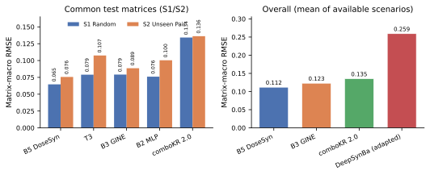

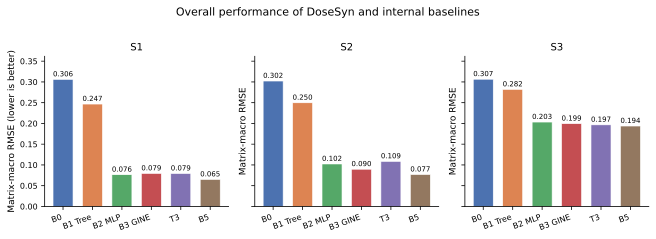

### 4.3.2 模型关键模块消融实验

M6-A 在同一 B3 主干上比较了对称融合、Fourier 剂量编码与 FiLM 条件调制（S1 seed42 与 S3 fold0 验证集）；其中 T2–T4 为控制变量对照，T0/T1 为参照，结果见表 4-3。

| Configuration | S1 val RMSE | S3 val RMSE |
| --- | --- | --- |
| T0 M4 B3 exact checkpoint | 0.0801 | — |
| T1 C0 ordered control + M4 recipe | 0.1820 | — |
| T2 B3-trunk + symmetric + scalar | 0.1015 | 0.1752 |
| T3 B3-trunk + symmetric + Fourier | 0.0820 | 0.1695 |
| T4 B3-trunk + symmetric + Fourier + FiLM | 0.0670 | 0.1734 |

以 T2（对称 + 标量剂量）为参照，引入 Fourier 编码的 T3 将 S1 验证 RMSE 从 0.1015 降至 0.0820（降低 19.2%），S3 从 0.1752 降至 0.1695（降低 3.3%）。在 T3 上加入 FiLM 的 T4 进一步将 S1 降至 0.0670（再降 18.4%），但 S3 略升至 0.1734（+2.3%）。这说明 FiLM 的收益依赖细胞覆盖：在已见细胞上收益明确，在未见细胞上需要正则化约束。

表 4-4 给出最终模型 B5 与未正则化 T3（B1）在全部 11 个划分上的正式结果。B5 相对 B1 在 S1、S2、S3 上分别降低 18.0%、29.3%、1.5%，等权平均降低 12.7%。

| Model | S1 RMSE | S2 RMSE | S3 RMSE | Mean | Params |
| --- | --- | --- | --- | --- | --- |
| B1 T3 (unregularized, no FiLM) | 0.0793 | 0.1085 | 0.1966 | 0.1281 | 498,818 |
| B5 DoseSyn (regularized FiLM) | 0.0650 | 0.0768 | 0.1937 | 0.1118 | 535,682 |

M5 阶段的组件开关实验是在较早的 C0 架构上进行的，仅用于说明各模块的边际作用，不能与 B5 的正式结果直接比较，列于附录表 4-4b。

| Variant | S1 validation RMSE |
| --- | --- |
| c0_control | 0.1820 |
| c1_symmetric | 0.1809 |
| c2_fourier | 0.1805 |
| c3_film | 0.1797 |
| c4_mono | 0.1800 |
| c5_boundary | 0.1803 |
| c6_full | 0.1870 |

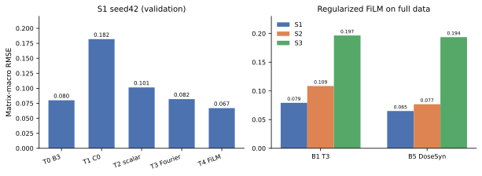

### 4.3.3 连续剂量表征与条件调制机制分析

DoseSyn 用 Fourier 特征编码连续剂量，并以零剂量标志位区分“真实为零”与“取对数后为零”，避免 `log10(0)` 的数值问题。与直接拼接标量剂量相比，Fourier 编码为解码器提供了多尺度剂量基函数，使同一解码器可在任意非负剂量坐标上查询，而不局限于 4 个离散水平。M6-A 的 T2→T3 对比是这一设计最直接的证据：在主干、掩码、优化器和预算完全一致的条件下，Fourier 编码把 S1 验证 RMSE 降低约 19%。

FiLM 条件调制把剂量表征映射为逐通道的缩放与偏置：

$$
(\gamma_i,\beta_i)=\mathrm{MLP}_\mathrm{dose}(e_i),\qquad t_i=(1+\gamma_i)\odot u_i+\beta_i ,
$$

其中 $u_i$ 为药物—细胞交互表征，$e_i$ 为剂量编码。零初始化的输出层使模型在训练初期退化为无调制的基线，再逐步学习剂量对交互强度的调制。B5 在 FiLM 输出层引入权重衰减与更高 dropout，并使用较小调制幅度；表 4-4 显示该正则化在保留 S1/S2 收益的同时，在 S3 上仍保持 1.5% 的小幅提升。

需要强调，上述分析说明的是“在已见药物/细胞条件下，连续剂量表征与条件调制带来稳定收益”，而不是“在所有未见条件下均优于 GINE”。S3 的正式结果（表 4-1）支持后者不成立。

### 4.3.4 中心剂量位置插值预测实验

M7-B 将每个 4×4 矩阵的中心 2×2（索引 `(1,1),(1,2),(2,1),(2,2)`）从训练监督中完全移除，只用其余 12 点训练，并在中心 4 点测试。该任务检验的是剂量网格位置插值，不是任意绝对浓度的外推。结果见表 4-5。

| Model | S1 center | S2 center | S3 center | Mean |
| --- | --- | --- | --- | --- |
| M6-B B5 (DoseSyn) | 0.0702 | 0.0811 | 0.2051 | 0.1188 |
| M4 B3 GINE | 0.0765 | 0.0898 | 0.2032 | 0.1232 |
| M6-B B1 (T3) | 0.0988 | 0.1185 | 0.2126 | 0.1433 |
| M4 B2 MLP-Dose | 0.0739 | 0.0921 | 0.2192 | 0.1284 |

B5 在 S1、S2 上分别为 0.0702 与 0.0811，相对 GINE 降低 8.3% 与 9.6%；S3 上 B5 为 0.2051，与 GINE 的 0.2032 相差约 0.9%。与完整 16 点训练相比，B5 的中心留出误差在 S1/S2/S3 上分别增加约 7.9%、5.7%、5.8%，说明模型具备可测量的网格插值能力，但并非无损。

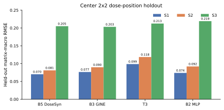

### 4.3.5 适度稀疏观测下的预测性能分析

在 50% 交错观测（8 个位置可观测）下，B5 与 GINE 在 S1/S2/S3 上的 held-out RMSE 分别为 0.0710/0.0838/0.2091 与 0.0784/0.0894/0.2095。B5 在 S1、S2 上仍保持优势（降低 9.4% 与 6.3%），S3 上两者基本持平。

在 25% 四角观测的极端稀疏条件下，B5 反而弱于 GINE（S1 0.1572 vs 0.1211）。该结果保留在实验档案中，不作为 B5 在极端稀疏条件下占优的证据；它提示 FiLM 的额外灵活性需要足够的观测密度支撑。

| Mask | Model | S1 | S2 | S3 | Mean |
| --- | --- | --- | --- | --- | --- |
| center_holdout_75 | M4 B3 GINE | 0.0765 | 0.0898 | 0.2032 | 0.1232 |
| center_holdout_75 | M6-B B5 (DoseSyn) | 0.0702 | 0.0811 | 0.2051 | 0.1188 |
| checkerboard_holdout_50 | M4 B3 GINE | 0.0784 | 0.0894 | 0.2095 | 0.1258 |
| checkerboard_holdout_50 | M6-B B5 (DoseSyn) | 0.0710 | 0.0838 | 0.2091 | 0.1213 |
| corners_holdout_25 | M4 B3 GINE | 0.1211 | 0.1273 | 0.2305 | 0.1596 |
| corners_holdout_25 | M6-B B5 (DoseSyn) | 0.1572 | 0.1839 | 0.2354 | 0.1922 |

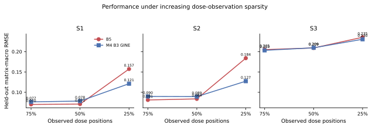

作为补充压力测试，表 4-7 给出高剂量边界外推（留出最高剂量 A 行与最高剂量 B 列共 7 点）。该任务与中心插值不同，B5 在 S1/S2/S3 上分别为 0.2340/0.2336/0.2640，明显弱于 GINE 的 0.1206/0.1229/0.2072。这说明 FiLM 的插值收益不能自动推广到高剂量边界外推；该结果作为模型适用范围的限制保留，不纳入正面结论。

| Model | S1 | S2 | S3 | Mean |
| --- | --- | --- | --- | --- |
| M4 B3 GINE | 0.1206 | 0.1229 | 0.2072 | 0.1503 |
| M6-B B5 (DoseSyn) | 0.2340 | 0.2336 | 0.2640 | 0.2439 |
| M6-B B1 (T3) | 0.2406 | 0.2367 | 0.2555 | 0.2443 |

### 4.3.6 药物组合交换对称性验证

对冻结的 B5 checkpoint，在 S1/S2/S3 全部测试矩阵上比较 $f(A,B,x,y,c)$ 与 $f(B,A,y,x,c)$（后者转置回原坐标）。结果见表 4-5b。

| Scenario | Matrices | Max abs error | Mean abs error | Matrices > 1e-5 |
| --- | --- | --- | --- | --- |
| S1 | 2786 | 0.000e+00 | 0.000e+00 | 0 |
| S2 | 2879 | 0.000e+00 | 0.000e+00 | 0 |
| S3 | 3836 | 0.000e+00 | 0.000e+00 | 0 |

三个场景的最大绝对误差均为 0.0e+00，说明药物顺序交换在数值上严格不改变预测。这一性质来自对称融合层只使用 $t_1+t_2$、$t_1\odot t_2$、$|t_1-t_2|$ 等对称组合，而不使用有序的 $[t_1,t_2]$ 拼接。该实验验证的是模型设计合理性，不作为预测精度的替代证据。

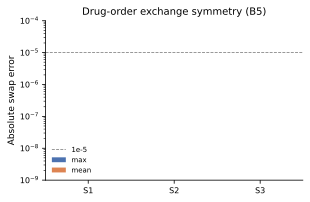

### 4.3.7 剂量响应曲面可视化与案例分析

案例选择规则在查看误差前固定：在测试矩阵中保留 `y_true` 标准差 ≥ 0.05 且极差 ≥ 0.2 的矩阵（2696 / 2786），按矩阵 RMSE 分位数选取第 10、50、90 百分位附近各一例。图 4-9 至 4-11 分别展示良好、中位与困难案例。

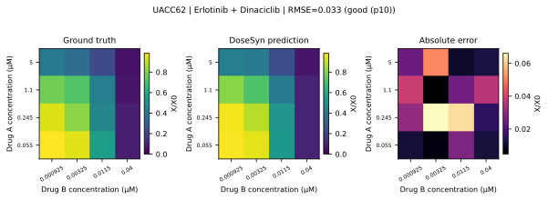

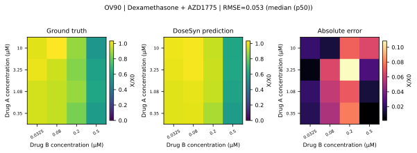

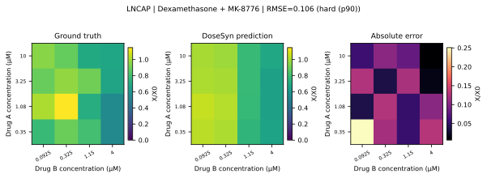

三个案例的 RMSE 分别为 0.033、0.053、0.106。良好案例中，模型准确复现了低剂量平台与高剂量抑制区域；困难案例的误差主要集中在高剂量角点，仍表现为幅度偏差而非曲面形状完全错位。

图 4-12 进一步给出中心留出插值案例：左侧 12 个观测点用于训练，中心 4 点为留出位置，模型在留出位置上的误差与周围观测点同一量级。图 4-13 为固定药物 A 剂量、沿药物 B 剂量变化的一维响应曲线。

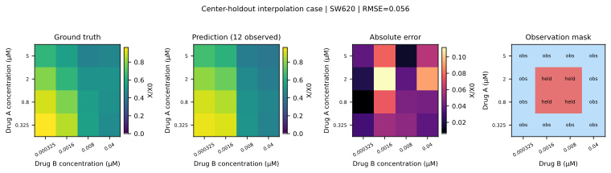

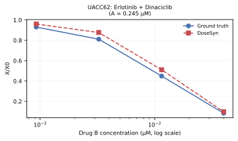

### 4.3.8 模型复杂度与计算效率分析

表 4-8 汇总参数量、训练时间与 CPU 推理耗时。

| Model | Params | S1 RMSE | S1 train wall (s) | Inference (ms/matrix, CPU) |
| --- | --- | --- | --- | --- |
| M4 B0 Mean | 1 | 0.3060 | 4.44 | — |
| M4 B1 Tree | 24,400 | 0.2467 | — | — |
| M4 B2 MLP | 65,153 | 0.0764 | 47.52 | — |
| M4 B3 GINE | 284,545 | 0.0795 | 239.22 | 0.12 |
| M6-B B1 (T3) | 498,818 | 0.0793 | 1063.00 | — |
| M6-B B5 (T3+FiLM) | 535,682 | 0.0650 | 928.40 | 0.18 |
| comboKR 2.0 | — | 0.1341 | — | — |
| DeepSynBa (adapted) | 11,560,833 | 0.2353 | — | — |

B5 的参数量为 535,682，仅比 T3（498,818）多 7.4%，但相对 B3（284,545）增加约 88%。在相同 CPU（4 线程）与相同 2,786 个测试矩阵上，B5 的平均推理耗时为 0.18 ms/矩阵，B3 为 0.12 ms/矩阵；两者均在亚毫秒级，满足批量筛选场景。训练时间方面，B5 在 S1 seed42 上为约 928 s（240 epoch），B3 为约 239 s（80 epoch）；按 epoch 折算约为 3.9 s 与 3.0 s，B5 的单步开销约高 29%，主要来自 FiLM 与更长的训练预算。

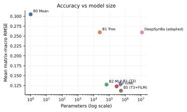

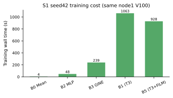

## 4.4 本章小结

本章在统一数据划分与评价口径下得到以下结论：

1. DoseSyn B5 在 S1、S2 上相对 GINE 分别降低 RMSE 18.2%、14.4%，等权平均降低 9.0%；S3 上略优于 GINE 2.8%，但幅度远小于 S1/S2。
2. 控制变量消融表明，Fourier 连续剂量编码与正则化 FiLM 是 S1/S2 收益的主要来源；FiLM 在未见细胞上需要正则化约束。
3. 中心 2×2 留出实验中，B5 在 S1/S2 优于 GINE 8.3%/9.6%，证明模型具备剂量网格位置插值能力；50% 观测下优势收窄，25% 极端稀疏下不再占优。
4. 冻结模型满足严格的药物顺序交换对称性（最大误差 0.0e+00）。
5. 预测曲面案例覆盖良好、中位与困难三档，误差主要出现在高剂量角点。

上述结论仅适用于本项目的 O'Neil 数据、冻结划分与 matrix-macro RMSE 口径，不外推为所有协同预测场景的普遍优势。
